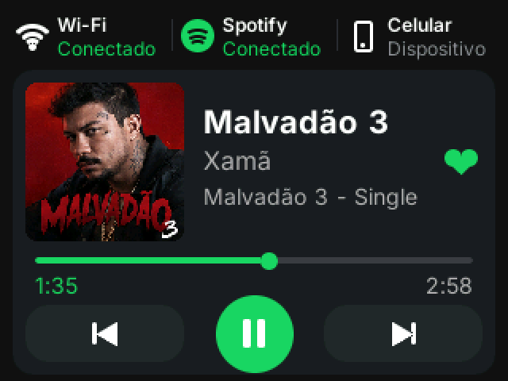
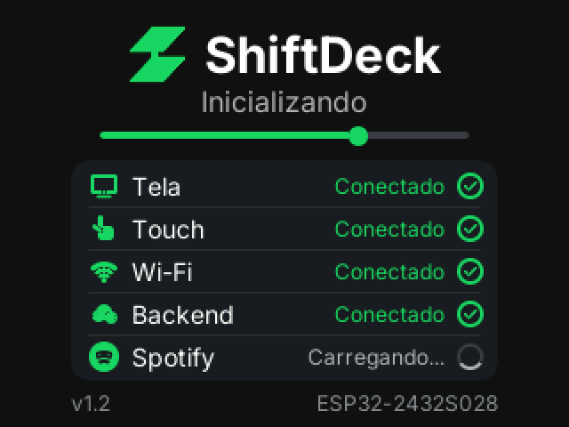
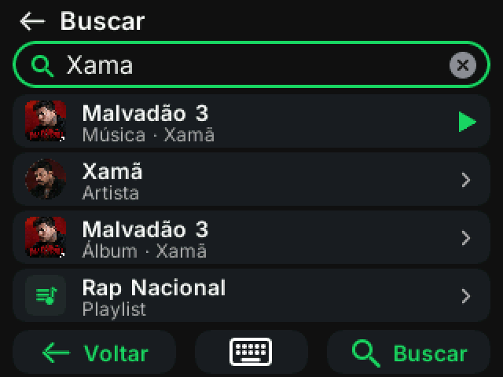
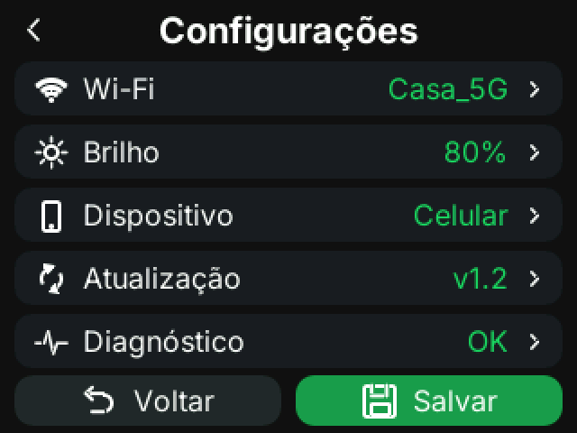
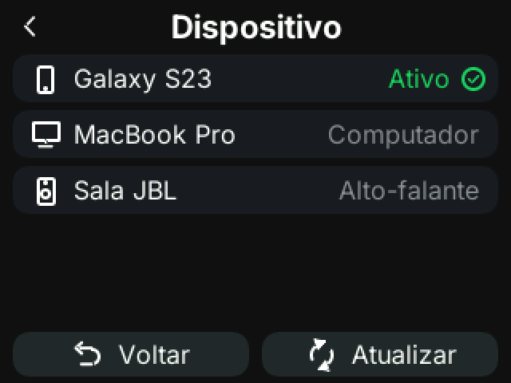
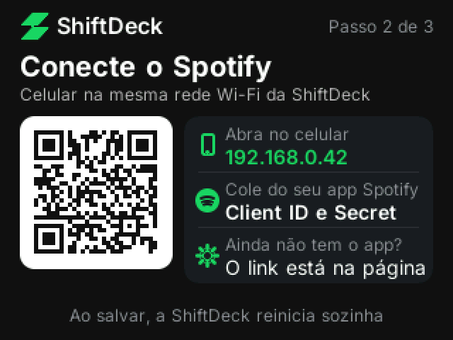

# ShiftDeck

Controle do Spotify com tela touch, no estilo Car Thing, rodando numa placa barata: a **ESP32-2432S028** ("Cheap Yellow Display", tela de 2,8" 320×240 com touch resistivo).

Mostra a música que está tocando com capa e progresso, controla play/pause/próxima/anterior, curte faixas, abre suas playlists, faz busca com teclado na tela e troca o dispositivo onde o Spotify toca. Fica sozinha na mesa ou no carro, ligada só na USB.

<p align="center"></p>

## Telas

<table>
<tr>
<td align="center"><br><sub>Inicialização: checklist de tela, touch, Wi-Fi e Spotify</sub></td>
<td align="center"><br><sub>Tocando agora: toque na capa, no coração ou nos controles</sub></td>
</tr>
<tr>
<td align="center"><br><sub>Playlists, com "Curtidas" no topo</sub></td>
<td align="center"><br><sub>Busca de músicas, artistas, álbuns e playlists</sub></td>
</tr>
<tr>
<td align="center"><br><sub>Teclado na tela</sub></td>
<td align="center"><br><sub>Configurações: Wi-Fi, brilho, dispositivo, versão, diagnóstico</sub></td>
</tr>
<tr>
<td align="center"><br><sub>Escolher onde o Spotify toca</sub></td>
<td align="center"><br><sub>Sem conexão: a tela avisa e continua tentando</sub></td>
</tr>
</table>

As imagens saem do simulador do projeto (`ShiftDeck-CYD/sim`), que roda o mesmo código de desenho do firmware.

## Do que você precisa

- Uma placa **ESP32-2432S028** (CYD). Existem versões com micro-USB, USB-C ou as duas; todas servem.
- Um **cabo USB de dados**. Muitos cabos de carregador só carregam: a placa acende, mas o computador não a enxerga.
- Uma conta **Spotify Premium**. A API do Spotify só deixa controlar a reprodução em contas Premium.
- Uma conta **Google**, para publicar a pequena ponte de login no Apps Script (de graça, explicada abaixo).
- **Chrome** ou **Edge** no computador, para o instalador web.

## Como funciona

```
                      Wi-Fi da sua casa
 ┌───────────┐  HTTPS (certificado verificado)  ┌──────────────────────┐
 │ ShiftDeck │ ───────────────────────────────▶ │ api.spotify.com      │
 │  (ESP32)  │ ◀─────────────────────────────── │ accounts.spotify.com │
 └─────▲─────┘        música, capa, comandos    └──────────────────────┘
       │ http://IP-da-placa (só no primeiro login)
 ┌─────┴─────┐   login no Spotify   ┌──────────────────────────────┐
 │  celular  │ ───────────────────▶ │ Google Apps Script (sua ponte)│
 └───────────┘ ◀─ volta p/ a placa ─└──────────────────────────────┘
```

- A placa fala direto com a API do Spotify. Não existe servidor do projeto no meio.
- **Por que o Apps Script?** O Spotify só aceita endereços de retorno do login em HTTPS público, e a placa só serve HTTP dentro da sua rede. A ponte no Apps Script recebe o código de login do Spotify e manda o celular de volta para `http://IP-da-placa/code`. Ela é usada só uma vez, no primeiro login.
- Depois do login, a placa guarda um *refresh token* e renova o acesso sozinha. Wi-Fi, Client ID/Secret e o token ficam só na memória da placa (LittleFS), nunca neste repositório.

## Instalação

### 1. Gravar o firmware

1. Abra **https://brachynuspro.github.io/shiftdeck-flasher/** no Chrome ou no Edge.
2. Ligue a placa no computador com o cabo de dados.
3. Clique em **Instalar do zero** (placa nova) ou **Atualizar firmware** (mantém Wi-Fi e conta).
4. Escolha a porta (`USB Serial`, `CH340`, `usbserial`…) e clique em **Install**. Se não conectar, segure **BOOT** enquanto clica.
5. Quando terminar, aperte **RST**.

Drivers: no **macOS** e no **Linux** não precisa instalar nada (o macOS já traz os drivers CH340/CP210x). No **Windows**, se a porta não aparecer, instale o [driver CH340](https://www.wch-ic.com/downloads/CH341SER_EXE.html).

### 2. Publicar a ponte no Google Apps Script

1. Abra [script.google.com](https://script.google.com) e crie um **Novo projeto**.
2. Apague o conteúdo e cole o arquivo [`appscript/Código.js`](appscript/C%C3%B3digo.js) deste repositório.
3. **Implantar → Nova implantação → App da Web**:
   - *Executar como*: **Eu**
   - *Quem pode acessar*: **Qualquer pessoa**
4. Autorize quando o Google pedir e copie a **URL do app da Web** (termina em `/exec`). Ela vai ser usada nos dois passos seguintes.

### 3. Criar o app no Spotify

1. Entre em [developer.spotify.com/dashboard](https://developer.spotify.com/dashboard) e clique em **Create app**.
2. Em **Redirect URIs**, cole a URL `/exec` do Apps Script, exatamente igual.
3. Marque **Web API** e salve.
4. Em **Settings**, copie o **Client ID** e o **Client Secret**.
5. Enquanto o app estiver em modo de desenvolvimento, adicione o e-mail da sua conta Spotify em **User Management**.

### 4. Configurar a placa

Na primeira vez, a ShiftDeck guia você por três telas. Em todas é só apontar a câmera do celular para o QR.

<table>
<tr>
<td align="center"></td>
<td align="center"></td>
<td align="center"></td>
</tr>
<tr>
<td><b>Passo 1: Wi-Fi.</b> O QR conecta o celular à rede <code>Shiftdeck-Spotify</code> e a página de configuração abre sozinha. Escolha a sua rede, digite a senha e salve. A placa reinicia.</td>
<td><b>Passo 2: Spotify.</b> Com o celular na mesma rede, o QR abre a página da placa. Cole o Client ID, o Client Secret e a URL do Apps Script. A placa reinicia.</td>
<td><b>Passo 3: Autorizar.</b> O QR abre a página de login. Toque em <b>Autorizar Spotify</b>, entre na sua conta e aceite. A tela mostra <b>Conectado!</b> e abre a música.</td>
</tr>
</table>

## Usando

| Onde tocar | O que acontece |
|---|---|
| Play/pause, ◀◀, ▶▶ | Controla a música no aparelho onde o Spotify está tocando |
| Coração | Curte ou descurte a faixa |
| Capa | Abre as playlists |
| Nome da música | Abre a busca |
| Barra de cima: Wi-Fi / Spotify / Dispositivo | Configurações / Playlists / Escolher dispositivo |

Se aparecer **"Nenhum dispositivo ativo"**, abra o Spotify em algum aparelho (celular, PC, caixa de som) uma vez; depois a ShiftDeck consegue tocar e trocar de aparelho sozinha.

## Problemas comuns

| Sintoma | Causa e solução |
|---|---|
| A placa acende, mas a porta não aparece no instalador | Cabo só de carga. Troque por um cabo de dados (teste: com ele o celular aparece no computador). |
| A porta some quando a tela acende | Falta energia: hub sem fonte ou conector frouxo. Ligue direto no computador ou num hub com fonte. |
| "Spotify Offline" na tela | Confira a internet do Wi-Fi. Se continuar, refaça o Passo 3 (a autorização pode ter sido revogada na conta Spotify). |
| Quero apagar tudo e configurar de novo | No instalador, use **Instalar do zero**: apaga Wi-Fi, conta e calibração. |

## Segurança e privacidade

- Nenhuma senha, token ou ID pessoal fica no código. Cada pessoa cria o próprio app no Spotify e a própria ponte no Apps Script.
- As conexões HTTPS da placa verificam o certificado do servidor com uma lista de autoridades raiz embutida no firmware (`ShiftDeck-CYD/certs/`, gerada por `tools/gen_crt_bundle.py`).
- A ponte do Apps Script guarda o código de login só até a placa buscá-lo. Esse código sozinho não serve para nada sem o seu Client Secret, que fica só na placa.
- `appscript/.clasp.json` (ID do seu projeto no Apps Script, se você usar o `clasp`) está no `.gitignore`.

## Desenvolver

Requisitos: [PlatformIO](https://platformio.org/) (`pip install platformio`) e Python 3 com Pillow e `cryptography` para as ferramentas.

```bash
cd ShiftDeck-CYD
pio run -e cyd                 # compila
pio run -e cyd -t upload       # grava via USB (só o app; mantém as configurações)
sh sim/run.sh                  # renderiza todas as telas em sim/out/*.png, sem placa
sh tools/release.sh --publish  # gera o firmware do instalador e publica a página
```

**Não** rode `pio run -t uploadfs` numa placa já configurada: ele sobrescreve a partição LittleFS onde ficam Wi-Fi, conta do Spotify e calibração.

Para atualizar a lista de certificados raiz (no macOS):

```bash
security find-certificate -a -p /System/Library/Keychains/SystemRootCertificates.keychain > roots.pem
python3 tools/gen_crt_bundle.py roots.pem certs/x509_crt_bundle.bin
```

### Publicar uma versão nova

1. Suba `VERSION` em `ShiftDeck-CYD/src/config.h`.
2. `sh tools/release.sh --publish` (dentro de `ShiftDeck-CYD/`, com o `gh` logado). A página do instalador atualiza em ~1 minuto.

## Estrutura

| Pasta | Conteúdo |
|---|---|
| `ShiftDeck-CYD/src` | Firmware (PlatformIO/Arduino): telas em `Views/`, desenho em `DisplayUI`, Spotify em `SpotifyPlayer`, configurações em `Vault` |
| `ShiftDeck-CYD/sim` | Simulador das telas no computador (TFT_eSPI real + emulador do ILI9341) |
| `ShiftDeck-CYD/flasher` | Página do instalador web (publicada no repositório `shiftdeck-flasher`) |
| `ShiftDeck-CYD/tools` | Fontes (`make_fonts.py`), certificados (`gen_crt_bundle.py`) e release (`release.sh`) |
| `ShiftDeck-CYD/certs` | Lista de autoridades raiz usada no HTTPS |
| `appscript` | Ponte de login no Google Apps Script |
| `docs/screens` | Imagens das telas usadas neste README |
| `IMGS` | Mockups de referência da interface |

## Documentação

- [Mapa de UX](ShiftDeck-CYD/MAPA_UX.md): mockups × firmware, decisões e próximos passos
- [Especificação da interface](PROJETO_SPOTIFY_CAR_ESP32_v1.2.md)
- [Arquitetura](PROJECT_ARCHITECTURE.md) · [Ferramentas e fluxo](TOOLS_AND_WORKFLOW.md) · [Histórico](DEVELOPMENT_JOURNEY.md)

## Licenças de terceiros

- Fonte Inter (`ShiftDeck-CYD/tools/fonts`): SIL Open Font License 1.1, https://github.com/rsms/inter
- SpotifyArduino (`ShiftDeck-CYD/lib/SpotifyArduino`): veja a licença na própria pasta.
- Spotify é marca da Spotify AB. Este projeto não é afiliado ao Spotify.
